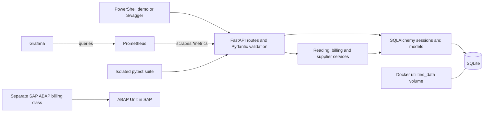

# Smart Meter Utilities DevOps Platform

An educational SAP Utilities-inspired portfolio project for a SWE Digital GmbH
interview. It is **not an actual SAP IS-U/IDEX implementation or a
regulatory-compliant GPKE solution**. Python runs the API; the separate ABAP
example demonstrates the billing calculation inside an SAP development system.

## Architecture



The API uses one database session per request. Supplier updates and their completed
history entries commit together. IDoc-inspired requests first save a received
message, then commit the reading and completed status together; handled failures
roll back the reading and save the failure reason. The ABAP example has no runtime
connection to the Python API.

## Features
- FastAPI REST API
- Meter/customer master data
- Meter reading validation
- Consumption and invoice calculation
- IDoc-inspired inbound messages and acknowledgements
- Educational electricity supplier switching with persistent request history
- SQLite persistence
- Prometheus metrics
- Docker and Docker Compose
- Pytest tests
- GitHub Actions CI
- ABAP billing class and ABAP Unit tests

## Quick start

### Local Python

From the project root in Windows 11 PowerShell, with Python 3.12 installed:

```powershell
py -3.12 -m venv .venv
.\.venv\Scripts\python.exe -m pip install -r requirements.txt
# For an existing database, follow the migration instructions below first.
.\.venv\Scripts\python.exe -m uvicorn app.main:app --host 127.0.0.1 --port 8000
```

Using the executable directly avoids needing to activate the environment.
`DATABASE_URL` defaults to `sqlite:///./utilities.db`, relative to the working
directory. Set `$env:DATABASE_URL` before starting the API to choose another file;
its parent directory must already exist. Stop the server with Ctrl+C.

Open:
- Swagger: http://localhost:8000/docs
- Health: http://localhost:8000/health
- Metrics: http://localhost:8000/metrics

### Docker

Start Docker Desktop with Linux containers first. From the project root:

```bash
docker compose config --quiet
docker compose up --build
```

Open:
- API: http://localhost:8000/docs
- Prometheus: http://localhost:9090
- Grafana: http://localhost:3000 (admin/admin)

Compose publishes ports on localhost only. The SQLite file is
`/app/data/utilities.db` in the named `utilities_data` volume, which survives
container replacement and `docker compose down`. **Do not use `down -v` to keep
your data.** Grafana/Prometheus have no configured persistent data volumes; their
runtime history/settings can disappear on container replacement.

## Reproducible Windows interview demo

The safest demo uses a fresh temporary SQLite database and automatically starts
and stops its own local API. It preserves your `DATABASE_URL` setting and does not
open your application database. With dependencies installed as above:

```powershell
powershell.exe -NoProfile -ExecutionPolicy Bypass -File .\demo\Start-Demo.ps1 -Python .\.venv\Scripts\python.exe -Repeat
```

`-Repeat` runs the demonstration twice against the same temporary database to
show that unique IDs prevent duplicate conflicts. Omit it for a single run.
Execution policy bypass applies only to this child PowerShell process. The script
prints each HTTP status and JSON response, checks the expected business outcomes,
and exits with an error if an assertion fails. It retains the temporary database
and server logs at the printed path for inspection. It was exercised with Windows
PowerShell 5.1; PowerShell 7 was not available during review.

To demonstrate against an API you have already started (including Docker):

```powershell
powershell.exe -NoProfile -ExecutionPolicy Bypass -File .\demo\Invoke-Demo.ps1 -BaseUrl http://127.0.0.1:8000
```

This second command **adds demo records to that API's database**. It deletes
nothing. Each run generates new customer, meter, switch, and message IDs. Reading
dates are consecutive UTC dates, and switching uses the current UTC date.

The script creates a customer and meter, submits readings 12450 and 12820,
checks the EUR 168.39 invoice, completes a supplier switch, saves a rejected
unchanged-supplier request, processes a valid meter message, and verifies an
unknown-meter message returns 404. Both switch results are retrieved again.
Failed message records are stored in SQLite; there is no message-history GET API.

See [the readiness report](demo/READINESS.md) for actual test results and remaining
Docker, CI, and SAP runtime limitations.

## API examples

Open `/docs` for editable schemas and use the PowerShell script for complete,
repeatable JSON examples. Decimal amounts are serialized as JSON strings.

| Operation | Endpoint | Example outcome |
| --- | --- | --- |
| Create customer | `POST /customers` | 201, `CREATED` |
| Create meter | `POST /meters` | 201; supplier defaults to `DEFAULT` |
| Add reading | `POST /readings` | 201, `VALIDATED` or `FLAGGED` |
| Calculate bill | `POST /bills/calculate/{meter_id}` | 200, total `168.39` for the demo |
| Request switch | `POST /supplier-switches` | 201, `COMPLETED` or `REJECTED` |
| Retrieve switch | `GET /supplier-switches/{request_id}` | 200, saved request; 404 if absent |
| Process message | `POST /market-messages/idoc` | 200, `COMPLETED`; validation errors use 4xx |
| Summary / health / metrics | `GET /dashboard/summary`, `/health`, `/metrics` | JSON summaries or Prometheus text |

Example reading body (replace `meter_id` with a created meter):

```json
{"meter_id":"MTR-1001","reading_date":"2026-07-18","reading_value":12820}
```

Example message body (use a new document number and a later reading date):

```json
{
  "control_record": {"document_number":"DOC-001","message_type":"METER_READING","sender":"DEMO","receiver":"UTILITIES"},
  "segments": [{"segment_type":"ZMETER","meter_id":"MTR-1001","reading_date":"2026-07-19","reading":12900}]
}
```

## Demo sequence
1. POST `/customers`
2. POST `/meters`
3. POST `/readings` for an initial reading
4. POST `/readings` for a later reading
5. POST `/bills/calculate/{meter_id}`
6. POST `/market-messages/idoc`
7. GET `/dashboard/summary`

## Supplier-switching simulation

This is an educational interview demo. It does not implement GPKE, SAP IS-U,
IDEX, supplier communication, or regulatory requirements.

Each meter has a `current_supplier`. Existing meter-creation requests still work:
if this optional field is omitted, it defaults to `DEFAULT`. You can also provide
an initial supplier when creating a meter. Supplier identifiers are case-sensitive;
surrounding whitespace is removed, and blank names are not allowed. `DEFAULT` is
a demo placeholder, not a real electricity supplier.

Use `POST /supplier-switches` with this JSON, replacing `requested_date` with
today's date in UTC:

```json
{
  "request_id": "SW-001",
  "customer_id": "CUST-501",
  "meter_id": "MTR-1001",
  "old_supplier": "DEFAULT",
  "new_supplier": "DEMO-ENERGY",
  "requested_date": "2026-11-07"
}
```

The simulation checks these rules in order and records the first rejection reason:

1. The customer and meter must exist.
2. The meter must belong to that customer and have status `ACTIVE`.
3. The old supplier must match the meter's current supplier.
4. The new supplier must differ from the old supplier.
5. The requested date must be today in UTC. Past and future dates are rejected;
   this simulation has no scheduling or waiting period.

A valid request immediately updates the meter and saves a `COMPLETED` request in
one database transaction. If saving either change fails, both changes are rolled
back. A conditional update also prevents overwriting a supplier changed by another
request while validation was running. Database failures are server errors, not
business rejections, and do not create a successful history entry.

Business rejections save a `REJECTED` request with a readable `rejection_reason`
and leave the supplier unchanged. Both accepted and rejected requests return
HTTP **201** because a history record was created. The response contains all
submitted fields plus `status`, `rejection_reason` (null on success), and
`created_at` (a UTC timestamp). Check `status` to determine the business outcome.

Use `GET /supplier-switches/SW-001` to retrieve the stored result; unknown request
IDs return **404**. Reusing any request ID, including a rejected one, returns
**409** and preserves the original record. Submit a corrected request with a new
ID. Missing fields, malformed dates, empty names, or overlong identifiers return
**422** before business processing and are not saved as history.

History stores the submitted customer and meter identifiers without foreign-key
constraints so it can also record requests for unknown customers or meters.
There are no endpoints to edit or delete history. Switching does not alter tariffs,
bills, readings, or market messages.

## Safely upgrading an existing SQLite database

New databases automatically receive the full schema. SQLAlchemy's `create_all()`
does not add columns to existing tables. The API therefore stops with a migration
instruction if an existing `meters` table lacks `current_supplier`.

Stop the API and all other database writers before migrating. Use the same
`DATABASE_URL` as the API; the local default is `sqlite:///./utilities.db`.
From the project directory, run:

```bash
python -m app.migrate_supplier_switches
```

The command requires an existing SQLite file. It first makes a uniquely named
`.bak` file beside it using SQLite's backup API, then adds the new column with
`DEFAULT` for existing meters and creates missing tables, including
`supplier_switches`. It does not drop tables or delete records. Schema changes
run in an explicit transaction, and rerunning the command preserves existing
suppliers and history. Keep the printed backup path. Restart the API after success.
This migration is SQLite-specific; other database engines need a separate migration.

For an existing Docker Compose database:

```bash
docker compose stop api
docker compose build api
docker compose run --rm --no-deps api python -m app.migrate_supplier_switches
docker compose up -d api
```

Compose uses `sqlite:////app/data/utilities.db`. The migration and backup operate
inside the persistent `utilities_data` volume. Do not remove that volume. For a
fresh installation, start Compose normally; there is no existing file to migrate.

If restoration is needed, stop all writers, preserve the current database and any
SQLite sidecar files separately, then restore the backup as the database file.
Restoring loses changes made after that backup; use the matching older application
or run the migration again before starting this version.

## ABAP billing and SAP execution

`abap/zcl_meter_billing.clas.abap` calculates the same default bill as Python:

1. Consumption = current reading minus previous reading.
2. Energy charge = consumption × EUR 0.35, rounded to two decimal places.
3. Subtotal = rounded energy charge + EUR 12.00 basic charge.
4. VAT = subtotal × 0.19, rounded to two decimal places.
5. Final total = subtotal + rounded VAT, rounded to two decimal places.

ABAP uses `decfloat34` and explicit `round( ... dec = 2
mode = cl_abap_math=>round_half_up )`. Halfway values round away from zero,
matching Python's `Decimal` with `ROUND_HALF_UP`. The ABAP subtotal is also
explicitly rounded to cents; with Python's fixed EUR 12.00 basic charge, the
subtotal already has cent precision. ABAP retains its optional tariff parameters;
use a basic charge with cent precision when comparing it with the Python formula.
See SAP's [rounding-function documentation](https://help.sap.com/docs/abap-cloud/abap-keyword/num-func-round-rescale).

For readings **12450 → 12820**, consumption is **370 kWh**, energy is
**EUR 129.50**, subtotal is **EUR 141.50**, VAT is **EUR 26.89** (rounded from
26.885), and the total is **EUR 168.39**. Equal readings still incur the basic
charge and VAT, giving **EUR 14.28** at the default tariff.

ABAP rejects negative or decreasing readings with `cx_sy_illegal_argument`.
`validate_reading` supplies a readable validation message. Python rejects these
inputs earlier through its input schema and reading service; its billing service
then uses the latest two stored readings. ABAP accepts two readings directly and
does not implement Python's database, meter-status, or reading-date checks.

### Running the ABAP code

1. Connect ADT (ABAP Development Tools in Eclipse) to an SAP development system
   with permission to create classes and run tests.
2. Create global class `ZCL_METER_BILLING` using the matching `.clas.abap` source.
   Paste the contents of `zcl_meter_billing_test.clas.testclasses.abap` into that
   class's **Test Classes** source section. It contains local class
   `ltc_meter_billing`; do not create a separate global billing-test class.
   These files are source snippets, not a complete abapGit export.
3. Syntax-check and activate the class and its local test classes. Choose
   **Run As → ABAP Unit Test** to execute the seven tests. They cover the standard
   invoice, decreasing readings, each negative-reading input, zero consumption,
   half-up energy rounding, and VAT calculated after energy rounding.
4. Create and activate `ZCL_METER_BILLING_DEMO` from its unchanged source. On a
   system providing `IF_OO_ADT_CLASSRUN`, choose **Run As → ABAP Application
   (Console)** to print the example bill. Decimal display formatting may omit
   trailing zeroes; the calculated amounts are rounded to cents.

These ADT actions are described in SAP's
[testing and execution guide](https://help.sap.com/docs/abap-cloud/abap-development-tools-for-visual-studio-code/testing-and-quality-checking).

### Compatibility and validation limits

The source uses modern ABAP features: inline declarations, `NEW`, `CONV`,
`decfloat34`, and the built-in `round` function. Check availability and permitted
APIs in the target SAP release and language version, especially ABAP Cloud API
restrictions and the demo's `IF_OO_ADT_CLASSRUN` interface. The exception type and
public method signatures are preserved. Raising the exception without a specific
text-ID constant avoids depending on that constant's availability. Successful
ABAP Unit methods declare the exception; rejection tests catch it explicitly.
Numeric expectations use `CONV decfloat34` to avoid string-versus-number comparisons.

ABAP Unit executes ABAP code **inside SAP**. Pytest executes the **Python** API
and service tests locally; Ruff checks Python code. Passing those checks does not
compile or test ABAP. No SAP ABAP runtime was available for this change, so the
ABAP code was reviewed statically and the ABAP Unit tests were **not executed**.

## Python checks

```bash
ruff check app tests
python -m pytest -q
```

Tests use temporary SQLite files and a fixed simulation date. They cover existing
billing/readings/IDoc behavior, switching and rejection history, rollback on a
database failure, and migration backups and preservation of existing rows.

## CI and limitations

GitHub Actions is configured for pushes to `main` and `feature/**`, pull requests
targeting `main`, and manual runs. It installs Python 3.12 dependencies, runs Ruff
and pytest, validates Compose, and builds the Docker image with read-only repository
permissions. It does not execute ABAP or the Windows demonstration script.
Local checks do not establish a successful remote workflow run; consult the
[Actions page](https://github.com/DarshanBakilanaRamesh/smart-meter-utilities-devops/actions)
and the readiness report for the observed status.

- This is a localhost demonstration with no authentication, authorization, TLS,
  rate limiting, or production secret management. Grafana uses demo credentials.
  Do not expose the stack publicly or enter real customer data.
- Supplier changes are synchronous, same-day UTC simulations. There is no GPKE
  messaging, actual supplier integration, switching scheduler, or SAP connection.
- Billing uses a fixed tariff and VAT rate; repeated bill requests create new
  records. There is no settlement, payments, invoice numbering, or billing-period
  deduplication. Readings are stored to three decimal places.
- SQLite is intended for small demos, not high concurrency. There is no automatic
  retry for database locks or reconciliation of a message left `RECEIVED` by a
  process crash. A persistent database outage can prevent saving a failure reason.
- Timestamp fields use UTC by convention but currently serialize without an offset.
  Only the documented SQLite migration is supplied; other database engines are
  not verified. Foreign keys are declared in models but SQLite enforcement is
  not explicitly enabled; application checks validate normal API relationships.
- No dependency vulnerability scan or penetration test was performed. Docker
  runtime/persistence testing and SAP activation/ABAP Unit still require their
  respective runtimes; see the readiness report before claiming those checks passed.
